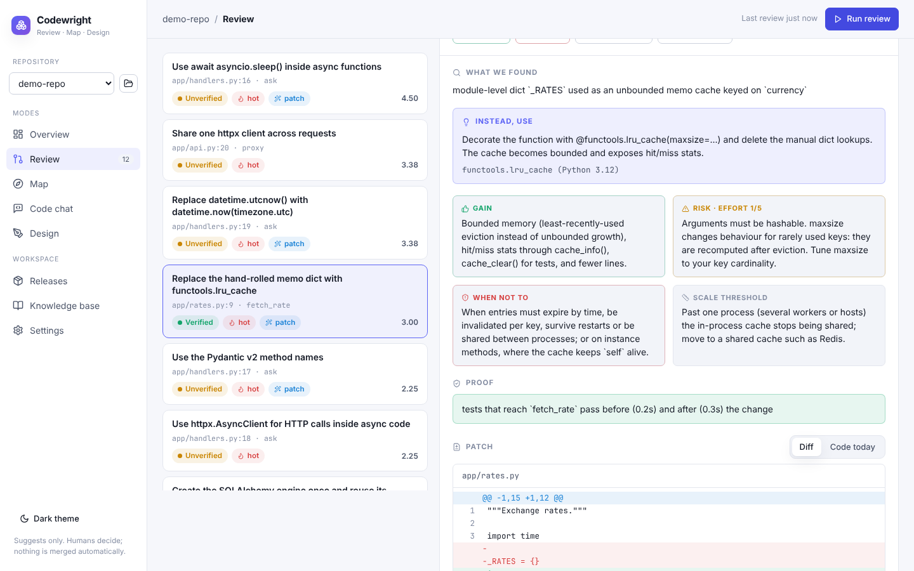
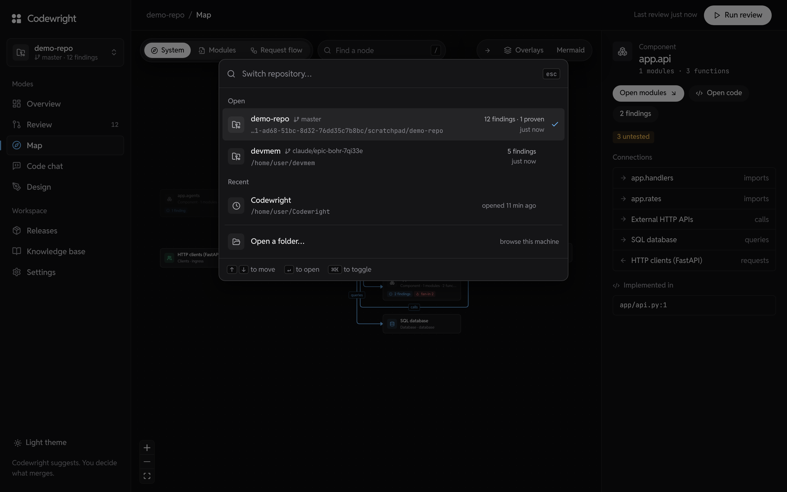

# Codewright

[](https://github.com/rushikeshjaisur11/codewright/actions/workflows/ci.yml)

[](https://github.com/astral-sh/ruff)


Codewright is a code and architecture advisor for Python repos. It reads your exact stack and library versions, finds code that rebuilds what a library, the standard library or the platform already does, and suggests the change with a diff, test-based proof and a clear "when not to".

A suggestion that can't name a file, an API version and a gain is never shown.

It has three modes that share one engine:

- **Review** improves existing code: ranked "instead of X, use Y" findings, each with a patch where it can be made mechanically.
- **Map** shows the current architecture as live diagrams linked to the code, with findings overlaid and a code chat that cites files and lines.
- **Design** drafts the architecture for a new project from a short interview, with capacity math in code, decision records and a starter repo. The design you choose becomes the target that Map and Review check for drift.



## Quick start

```bash
uv venv && uv pip install -e ".[dev]"      # add [llm] for model-written chat answers
.venv/bin/codewright serve path/to/repo    # web app on http://127.0.0.1:8765
```

Everything runs locally and the code is never uploaded. A model is optional (see [Models](#models)).

## Web app

| Page | What it does |
| --- | --- |
| Overview | Findings, proof rate, acceptance rate, hot-path count, stack, drift and upgrades at a glance |
| Review | Filterable findings with evidence, the suggested API and version, gain, risk, "when not to", scale threshold, proof, diff and sources. Accept, reject (with a reason), mute an intent, copy or apply a patch, PR mode and PR-comment export |
| Map | System, module and request-flow diagrams generated from the code graph, laid out with ELK (layered, orthogonal edges). Hover a box to trace its connections, double-click to drill in (breadcrumbs take you back), press `/` to find a node, filter by kind, switch direction. Every box links to its files and lines; overlays show findings, fan-in hotspots and untested code. Monorepos (`packages/*`, `src/` layouts) are split into their real packages. Mermaid export, drift panel and "changes this week" |
| Code chat | Questions about the code, answered with citations you can click open |
| Design | Interview → three candidate architectures with fit scores, a diagram, components with exact versions from PyPI, editable capacity assumptions, decision records, data model and API outline. Download the design doc or a starter repo, or save the design as the repo's intended architecture |
| Releases | Newer versions of each dependency and the capability cards an upgrade would unlock |
| Knowledge base | Every capability card, searchable |
| Settings | Model, offline mode, team constraints, mute rules, MCP and CI snippets |
| Repo switcher | Press `⌘K` / `Ctrl+K`: switch between open repos (branch, findings, last review), reopen recent ones (remembered in `~/.codewright/recent.json`) or browse this machine's folders to open a new one |

| Overview | Map |
| --- | --- |
|  |  |
| **Design** | **Repo switcher (⌘K)** |
|  |  |
| **Light theme** | |
|  | |

## Command line

```bash
codewright review .                         # ranked findings in the terminal (runs proof by default)
codewright review . -j 8                    # run up to 8 patched test suites at once
codewright review . -f markdown -o report.md
codewright review . --base origin/main -f pr -o comment.md   # PR mode: changed code only
codewright check .                          # exit 1 when code drifts from .codewright/design.json
codewright map . --level flow               # Mermaid diagram of a request flow
codewright watch . --rescan                 # new dependency releases; re-review when one appears
codewright feedback <finding-id> rejected --reason "not worth the churn"
codewright stack .                          # what versions it thinks you run
codewright graph .                          # functions, call edges and entry points
codewright mcp                              # MCP server on stdio for coding agents
```

### In CI

```yaml
- run: pip install "codewright @ git+https://github.com/rushikeshjaisur11/codewright"
- run: codewright review . --base origin/${{ github.base_ref }} -f pr -o codewright.md
- run: codewright check .
```

Post `codewright.md` as a PR comment with your usual comment action. Codewright suggests; it never merges.

### For coding agents

```json
{ "mcpServers": { "codewright": { "command": "codewright", "args": ["mcp"] } } }
```

Tools: `review`, `review_markdown`, `explain_finding`, `record_feedback`, `architecture_map`, `ask_code`, `check_drift`, `dependency_releases`.

## How a review works

| Step | Module | What it does |
| --- | --- | --- |
| 1. Stack discovery | `stack.py` | Reads `uv.lock`, `poetry.lock`, `Pipfile.lock`, `requirements*.txt`, `pyproject.toml`, `.python-version` and Dockerfiles. Lockfile versions beat declared ranges |
| 2. Code graph | `graph.py` | Its own tree-sitter indexer: imports, classes, functions, decorators, call edges and entry points. Calls resolve through imports (relative imports and package re-exports included), enclosing scopes, `self`/`super()` and base classes; a call on an object of unknown type is matched by method name only when the name isn't one builtin types already have (`d.items()` never links to your `items`). Code reachable from an entry point is on the hot path |
| 3. Intent detection | `intents/` | Labels functions with the engineering intent they implement by hand (17 intents) |
| 4. Capability cards | `cards/data/*.yaml` | Per library and version: the API, gain, effort, risk, "when not to", scale threshold and sources. Preference: already installed, then stdlib, then platform, then a new dependency |
| 5. Suggestion | `suggest.py` | Picks the best card and writes the smallest safe diff when the code's shape allows it |
| 6. Critic | `critic.py` | Drops findings missing a file, an API version, a gain, effort, risk, threshold, "when not to" or a source, and checks that the suggested symbol exists in the repo's own interpreter |
| 7. Proof | `proof.py` | Runs `pytest` in a temp copy before and after the patch. The baseline run records which tests actually execute each function (`sys.monitoring` on 3.12+, a profile hook on 3.11). **Verified** only when the suite passes both times *and* a test ran the changed function, and the finding names that test. Patched runs go in parallel (`--jobs`, default: CPUs up to 4); one that fails in parallel is re-run alone before the patch is blamed. The copy's `src/` folders go first on the path, so an editable install can't make the tests run the unpatched original. A patch that breaks tests is dropped |
| 8. Feedback and ranking | `feedback.py`, `rank.py` | Impact (×1.5 on the hot path) × confidence × team acceptance for that intent ÷ effort |

### Intents

| Intent | Suggests | Auto-patch |
| --- | --- | --- |
| Memo cache dict | `functools.lru_cache` | yes |
| `time.sleep` in `async def` | `await asyncio.sleep` | yes |
| Durations with `time.time()` | `time.perf_counter()` | yes |
| `datetime.utcnow()` | `datetime.now(timezone.utc)` | yes |
| Pydantic v1 methods on v2 | `model_validate`, `model_validate_json`… | yes |
| Retry loop with sleep | `tenacity` | |
| Blocking `requests` in `async def` | `httpx.AsyncClient` | |
| Connection or client per request | SQLAlchemy engine reuse, psycopg/asyncpg pools, shared httpx client or requests Session | |
| Polling loop over a jobs table | Postgres `FOR UPDATE SKIP LOCKED` + `LISTEN/NOTIFY` | |
| Hand-written agent orchestration (ADK) | ADK 2.0 graph workflows, or `SequentialAgent` on 1.x | |
| `@app.on_event` | FastAPI lifespan | |
| `session.query()` on SQLAlchemy 2.x | `select()` | |
| Manual counting, grouping, thread fan-out | `Counter`, `defaultdict`, `ThreadPoolExecutor` | |
| `os.system` | `subprocess.run` with an argument list | |
| `+=` string building in a loop | `"".join()` | |

Add your own cards: put YAML files in a folder and pass `--cards that/folder`. Each card needs `sources` and a `when_not`, or the critic drops its findings.

## State in your repo

Codewright keeps its state in `.codewright/`:

| File | Purpose | Commit it? |
| --- | --- | --- |
| `feedback.json` | Accepted, rejected and muted findings, mute rules, team constraints | yes, so the team shares it |
| `design.json` | The intended architecture from Design mode, checked by `codewright check` | yes |
| `config.json` | Model and offline mode | yes |
| `snapshots/`, `releases.json` | Map history and PyPI cache | no (ignored automatically) |

## Models

Review, the critic, proof, Map and Design's capacity math are deterministic and never call a model. A model only writes code-chat answers and drafts Design's data model; without one, chat answers are built from the code graph and still cite files and lines.

Models go through LiteLLM (`pip install "codewright[llm]"`). The default is `vertex_ai/gemini-2.5-flash`; set `CODEWRIGHT_MODEL` or change it in Settings. `CODEWRIGHT_OFFLINE=1` (or the Settings switch) guarantees no model calls.

## Development

```bash
.venv/bin/ruff check . && .venv/bin/ruff format --check .   # lint and format (CI runs both)
.venv/bin/pytest -q                       # Python tests
cd web && npm install && npm run build    # rebuilds the UI into src/codewright/web
npm run dev                               # UI dev server, proxies /api to codewright serve on :8765
```

CI (`.github/workflows/ci.yml`) runs ruff, the tests on Python 3.11, 3.12 and 3.13, and the UI build on every pull request.

The UI follows one small design system: neutral charcoal greys in the dark theme, with blue kept for links, focus and selection (a white and link-blue light theme), Reddit Sans with JetBrains Mono (bundled, so nothing loads from the network), sharp corners and pill buttons. Colour marks state only (proof, diff lines, findings).
