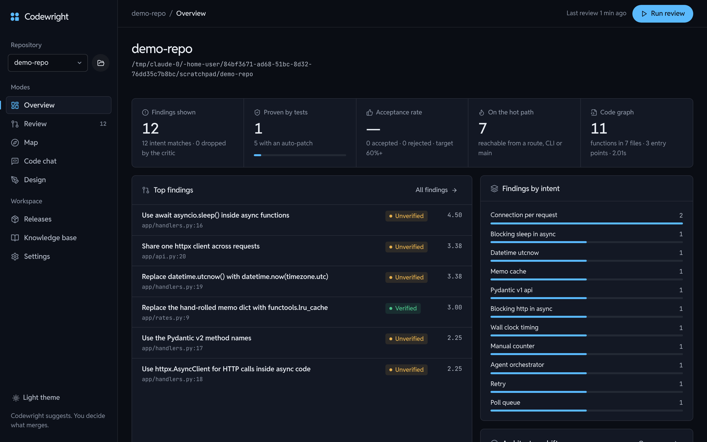
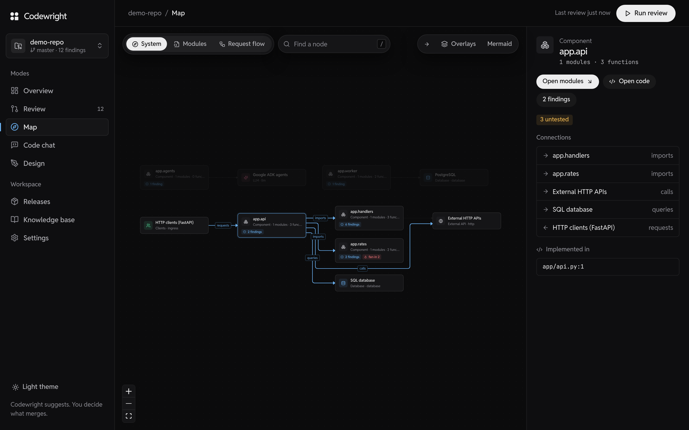
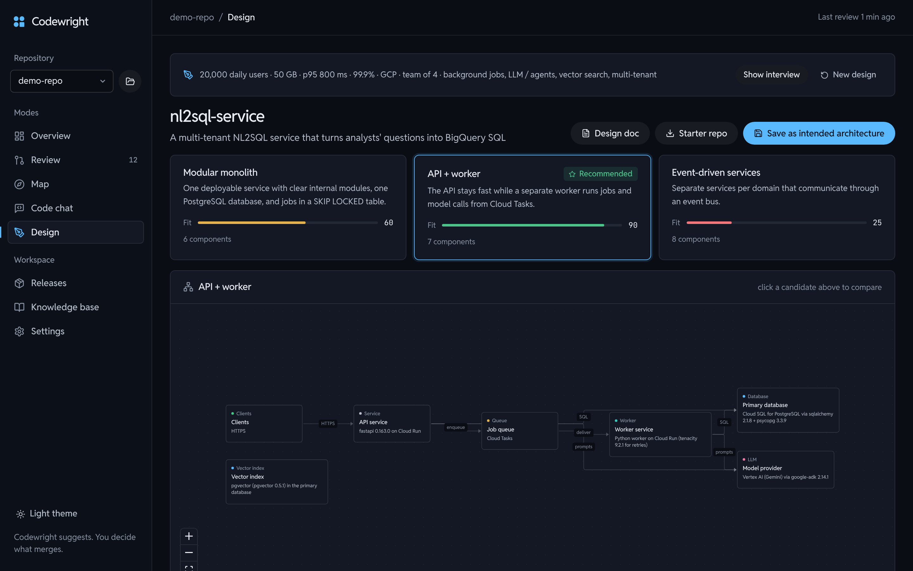
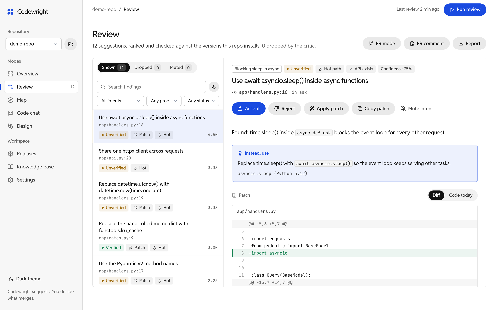

# Codewright

[](https://github.com/rushikeshjaisur11/codewright/actions/workflows/ci.yml)

[](https://github.com/astral-sh/ruff)


Codewright is a code and architecture advisor for Python repos. It reads your exact stack and library versions, finds code that rebuilds what a library, the standard library or the platform already does, and suggests the change with a diff, test-based proof and a clear "when not to".

A suggestion that can't name a file, an API version and a gain is never shown.

It has three modes that share one engine:

- **Review** improves existing code: ranked "instead of X, use Y" findings, each with a patch where it can be made mechanically.
- **Map** shows the current architecture as live diagrams linked to the code, with findings overlaid and a code chat that cites files and lines.
- **Design** drafts the architecture for a new project from a short interview, with capacity math in code, decision records and a starter repo. The design you choose becomes the target that Map and Review check for drift.


## Quick start

```bash
uv venv && uv pip install -e ".[dev]"
.venv/bin/codewright serve path/to/repo    # web app on http://127.0.0.1:8765
```

Everything runs locally and the code is never uploaded. A model is optional (see [Models](#models)).

The web app only answers requests addressed to `localhost`, and refuses requests sent from other websites, so a page you have open can't read your code through it. To reach it from another machine, bind it with `--host 0.0.0.0` and name each host it's reached by with `--allow-host`.

## Web app

| Page | What it does |
| --- | --- |
| Overview | Findings by kind, architecture suggestions, proof rate, acceptance rate, hot-path count, stack, drift and upgrades at a glance |
| Review | Findings tagged by kind (**Architecture**, Agents, Performance, Reliability, Upgrade, Use the library) and filterable by it, with evidence, the suggested API and version, gain, risk, "when not to", scale threshold, proof, diff and sources. Accept, reject (with a reason), mute an intent, copy or apply a patch, PR mode and PR-comment export |
| Map | System, module and request-flow diagrams generated from the code graph, laid out with ELK (layered, orthogonal edges). Hover a box to trace its connections; click any box for an inspector with what it is, its facts, links, the suggestions in its code and the code itself (components, modules, functions and external systems alike); **Focus** shows only a box and its neighbours, and *Ask about it* opens Code chat with a question about it. Double-click to drill in (breadcrumbs take you back), press `/` to find a node, filter by kind, switch direction. Every box links to its files and lines; overlays show findings, fan-in hotspots and untested code. Files the running system never loads (nothing in use imports them, only tests do, or they live in `scripts/`, `docs/` or `examples/`) are left off and listed beside the map, with a switch to show them. Monorepos (`packages/*`, `src/` layouts) are split into their real packages. Entry points include files that start the app, not only routes and `main()`: an `app.py` or other script nothing imports, Streamlit, Chainlit, Gradio, NiceGUI and Panel apps, FastAPI/Flask/Starlette/Django/Dash/Celery/Typer/MCP app objects (shown as `uvicorn app:app`, `streamlit run app.py`...), module-level starts such as `app.run()` or `asyncio.run(main())`, `__main__` blocks, `__main__.py`, console scripts in pyproject, and handlers like `@mcp.tool` or `@cl.on_message`. Mermaid export, drift panel and "changes this week" |
| AI & agents | The files that need a model, and the agent architecture drawn from the code: which route or job runs each agent, its sub-agents and handoffs, its tools and model, plus LangGraph workflows and direct model calls. Every box opens the same inspector: an agent's model, full instruction, options, tools, sub-agents, who runs it and its definition; a tool's signature, docstring and code; a model's users and call sites. Search, kind filters, Focus and Mermaid export work as on the Map. Google ADK, OpenAI Agents SDK, Pydantic AI, CrewAI, LangChain/LangGraph, smolagents, AutoGen, LlamaIndex, and the Anthropic, OpenAI, Gemini and LiteLLM SDKs |
| Code chat | Questions about the code, answered with citations you can click open |
| Design | Interview → three candidate architectures with fit scores, a diagram, components with exact versions from PyPI, editable capacity assumptions, decision records, data model and API outline. Download the design doc or a starter repo, or save the design as the repo's intended architecture |
| Releases | Newer versions of each dependency, what an upgrade unlocks, and an upgrade preview for this repo: the findings an upgrade would add (things to fix first, with auto-patches marked) or resolve, from re-matching the code already scanned against the new version |
| Knowledge base | Every card, searchable and grouped by library and topic. With a repo open, each says whether it fits the locked version, needs an upgrade or isn't a dependency. Cards with a detector become findings; reference entries are for looking things up |
| Settings | Model setup (provider, key, save and test), offline mode, team constraints, mute rules, MCP and CI snippets |
| Live review | **Go live** in the top bar re-reviews on every save (tests not run) and says what became new or resolved |
| Repo switcher | Press `⌘K` / `Ctrl+K`: switch between open repos (branch, findings, last review), reopen recent ones (remembered in `~/.codewright/recent.json`) or browse this machine's folders to open a new one |

| Overview | Map |
| --- | --- |
|  |  |
| **Design** | **Repo switcher (⌘K)** |
|  |  |
| **Light theme** | |
|  | |

## Command line

```bash
codewright review .                         # ranked findings in the terminal (runs proof by default)
codewright review . -j 8                    # run up to 8 patched test suites at once
codewright review . -f markdown -o report.md
codewright review . --watch                 # re-review on every save; prints new and resolved findings
codewright review . -f sarif -o codewright.sarif   # for GitHub code scanning and other SARIF viewers
codewright review . --base origin/main -f pr -o comment.md   # PR mode: changed code only
codewright check .                          # exit 1 when code drifts from .codewright/design.json
codewright map . --level flow               # Mermaid diagram of a request flow
codewright map . --unused                    # also draw files the running system never loads
codewright agents .                         # files that need a model, and the agents, tools and models
codewright agents . --mermaid               # the agent architecture as Mermaid
codewright watch . --rescan                 # new dependency releases; re-review when one appears
codewright feedback <finding-id> rejected --reason "not worth the churn"
codewright stack .                          # what versions it thinks you run
codewright graph .                          # functions, call edges and entry points
codewright mcp                              # MCP server on stdio for coding agents
codewright mcp --http --host 0.0.0.0        # one shared MCP server for a team (see below)
codewright cards verify --python .venv/bin/python --links   # every card's API exists in the installed version; sources resolve
```

### In CI

The repository is also a GitHub Action. On pull requests it reviews only the lines the PR changed, shows findings as code-scanning alerts on the diff, and writes a summary with the suggested patches to the job page:

```yaml
on: pull_request
permissions:
  contents: read
  security-events: write   # to upload code-scanning alerts
  actions: read            # needed by the upload in private repositories
# Uploading needs code scanning enabled for the repository (in private repositories, GitHub Code
# Security). Without it, pass `upload-sarif: false`; the review summary still appears on the run.
jobs:
  codewright:
    runs-on: ubuntu-latest
    steps:
      - uses: actions/checkout@v4
      - uses: rushikeshjaisur11/codewright@main
        # with: { proof: "true" }   # also run the tests before and after each patch
```

Or call the CLI yourself:

```yaml
- run: pip install "codewright @ git+https://github.com/rushikeshjaisur11/codewright"
- run: codewright review . --base origin/${{ github.base_ref }} -f pr -o codewright.md --sarif-output codewright.sarif
- run: codewright check .
```

Codewright suggests; it never merges.

### For coding agents (MCP)

Codewright is an MCP server, so Claude Code, Cursor, VS Code, Copilot, Devin and other agents can call it. Use it **locally** (nothing to host; it reviews folders on your machine) or run **one shared server for the team** (nobody installs anything).

Each tagged release publishes a container image (`ghcr.io/rushikeshjaisur11/codewright`) and attaches the wheel to the GitHub release (`.github/workflows/release.yml`).

**Local**, one line, nothing to install first (uv fetches it):

```bash
claude mcp add codewright -- uvx --from git+https://github.com/rushikeshjaisur11/codewright codewright mcp
```

`codewright mcp config` prints the same setup for Cursor, VS Code, Claude Desktop and other clients.

**Shared server for a team**, over Streamable HTTP at `/mcp`:

```bash
export CODEWRIGHT_MCP_TOKENS=$(codewright mcp token)        # one per person or team; comma-separated
codewright mcp --http --host 0.0.0.0 --port 8765 --root /srv/repos/shop --root /srv/repos/billing
# or in a container:
docker build -t codewright .
docker run -p 8765:8765 -e CODEWRIGHT_MCP_TOKENS=... -v /srv/repos/shop:/repos/shop codewright --root /repos/shop
```

Then each person runs `codewright mcp config --url https://codewright.example.com` and pastes what it prints. For Claude Code that is:

```bash
claude mcp add --transport http codewright https://codewright.example.com/mcp --header "Authorization: Bearer $CODEWRIGHT_TOKEN"
```

On a shared server, a tool's `repo` is one of:
- the name of a repository the server was started with (`--root`);
- a git URL on an allowed host (`https://github.com/org/repo`, `#branch` for a branch), cloned shallowly into the server's cache and refreshed when older than 5 minutes. Private repos use the server's `CODEWRIGHT_GIT_TOKEN`, `~/.netrc` or git credential helper. Set other hosts with `--git-host git.corp.example`, or turn this off with `--no-git`;
- nothing: `review_files` reviews files the agent sends inline (the files it's editing plus `uv.lock`, `requirements.txt` or `pyproject.toml`, so versions match). Nothing is kept.

**Sign-in with your identity provider (SSO).** Instead of handing out tokens, let people sign in through Okta, Microsoft Entra ID, Google, Keycloak or any OpenID Connect provider:

```bash
codewright mcp --http --host 0.0.0.0 --public-url https://codewright.example.com/mcp \
  --sso-issuer https://login.example.com/oauth2/default --allowed-domain example.com --root /srv/repos/shop
```

The server then follows the MCP authorization model. It publishes `/.well-known/oauth-protected-resource` naming your provider, MCP clients that support OAuth send the user there to sign in, and each request carries the resulting access token. Codewright checks the token's signature against the provider's published keys, its issuer, audience (`--sso-audience`, default the public URL), expiry, optional scopes (`--sso-scope`) and the user's email domain (`--allowed-domain`). `--token` still works alongside, for CI and scripts. If your provider doesn't allow clients to register themselves, register one there for your MCP clients.

What the shared server guards:
- **Tokens or SSO.** Every request needs a bearer token or a signed-in user; `/healthz` and the OAuth metadata are the only open paths. The server refuses to listen on a non-local address without tokens or SSO unless you pass `--no-auth` (for when a gateway in front authenticates).
- **No repository code runs.** Proof runs a repo's tests and installs its dependencies, so it's off unless you start with `--allow-proof`.
- **Access.** Callers reach only the `--root` repos and allowed git hosts. Clones use https only (no `file://`, `ssh` or `ext::`), with no hooks and no LFS downloads. Inline files can't escape their throwaway folder.
- **Host headers.** `--public-host codewright.example.com` refuses requests that don't use that name, and a server bound to localhost is protected against DNS rebinding.

Tools: `review`, `review_files`, `review_markdown`, `explain_finding`, `record_feedback`, `architecture_map`, `ai_architecture` (agents, tools, models and the files that need a model), `ask_code`, `check_drift`, `dependency_releases`, `search_knowledge` (what the installed version of a library offers for a task, before writing code against it), `list_repos`.

## How a review works

| Step | Module | What it does |
| --- | --- | --- |
| 1. Stack discovery | `stack.py` | Reads `uv.lock`, `poetry.lock`, `Pipfile.lock`, `requirements*.txt`, `pyproject.toml`, `.python-version` and Dockerfiles. Lockfile versions beat declared ranges. In a monorepo each file is judged on its nearest project's files, layered over the root's (so a uv workspace's root lock still supplies versions) |
| 2. Code graph | `graph.py` | Its own tree-sitter indexer: imports, classes, functions, decorators, call edges and entry points. Calls resolve through imports (relative imports and package re-exports included), enclosing scopes, `self`/`super()` and base classes; a call on an object of unknown type is matched by method name only when the name isn't one builtin types already have (`d.items()` never links to your `items`). Code reachable from an entry point is on the hot path |
| 3. Intent detection | `intents/` | Labels functions with the engineering intent they implement by hand, plus whole-codebase architecture checks (48 intents) |
| 4. Capability cards | `cards/data/*.yaml` | Per library and version: the API, gain, effort, risk, "when not to", scale threshold and sources. Preference: already installed, then stdlib, then platform, then a new dependency |
| 5. Suggestion | `suggest.py` | Picks the best card and writes the smallest safe diff when the code's shape allows it |
| 6. Critic | `critic.py` | Drops findings missing a file, an API version, a gain, effort, risk, threshold, "when not to" or a source, and checks that the suggested symbol exists in the repo's own interpreter. A symbol whose library isn't installed there, or whose module needs an optional extra, counts as unchecked, not missing |
| 7. Proof | `proof.py`, `proof_env.py` | Runs `pytest` in a sandbox copy of the repo (with its `.git`, so tests that call git work) before and after the patch. The tests run with the repo's own dependencies: `--python`, else the repo's `.venv`, else an environment built once from `uv.lock` or `requirements*.txt` with uv and cached in `~/.codewright/envs` (nothing is written into the repo). The baseline run records which tests actually execute each function (`sys.monitoring` on 3.12+, a profile hook on 3.11). **Verified** only when the tests pass both times *and* a test ran the changed function, and the finding names that test. Each patch then runs just the test files that run the function or import its module, directly or through other modules (`--full-suite` runs everything), in parallel (`--jobs`); a run that fails in parallel is re-run alone before the patch is blamed. When the baseline fails, the finding says why: a failing test, tests that can't import the project, or no tests collected. A patch that breaks tests is dropped |
| 8. Feedback and ranking | `feedback.py`, `rank.py` | Impact (×1.5 on the hot path) × confidence × team acceptance for that intent ÷ effort |

### Intents

| Intent | Suggests | Auto-patch |
| --- | --- | --- |
| Memo cache dict | `functools.lru_cache` | yes |
| `time.sleep` in `async def` | `await asyncio.sleep` | yes |
| Durations with `time.time()` | `time.perf_counter()` | yes |
| `datetime.utcnow()` | `datetime.now(timezone.utc)` | yes |
| Pydantic v1 methods on v2 | `model_validate`, `model_validate_json`… | yes |
| Retry loop with sleep | `tenacity`; `autoretry_for` inside a Celery task | |
| Blocking `requests` in `async def` | `httpx.AsyncClient` | |
| Connection or client per request | SQLAlchemy engine reuse, psycopg/asyncpg pools, shared httpx client or requests Session | |
| Polling loop over a jobs table | Postgres `FOR UPDATE SKIP LOCKED` + `LISTEN/NOTIFY` | |
| Google ADK 2.x agents (18 intents) | See [Google ADK](#google-adk) | 3 of them |
| `@app.on_event` | FastAPI lifespan | |
| `requests.get(...)` without `timeout=` | A `(connect, read)` timeout: requests never times out by default | |
| Pydantic 1 `@validator` / `@root_validator` on Pydantic 2 | `@field_validator` / `@model_validator` | yes, for `(cls, value)` validators |
| `class Config:` inside a Pydantic 2 model | `model_config = ConfigDict(...)` | yes, when every option is a v2 name |
| Pydantic 1 option names (`orm_mode`, `anystr_strip_whitespace`...) on Pydantic 2, which ignores them | Their v2 names: the model starts doing what its config says | |
| `from pydantic import BaseSettings` on Pydantic 2 (an import error) | `pydantic_settings.BaseSettings` | |
| `sqlalchemy.ext.declarative` on SQLAlchemy 2 | `sqlalchemy.orm.declarative_base`, then `DeclarativeBase` | yes, the import |
| `session.query()` on SQLAlchemy 2.x | `select()` | |
| Manual counting, grouping, thread fan-out | `Counter`, `defaultdict`, `ThreadPoolExecutor` | |
| `os.system` | `subprocess.run` with an argument list | yes, for a plain command whose result is unused |
| `+=` string building in a loop | `"".join()` | |
| FastAPI `q: str = Query(None)`, `db: Session = Depends(get_db)` (FastAPI 0.95.1+) | `q: Annotated[str, Query()] = None`, and one `SessionDep = Annotated[...]` type for a dependency used in 3+ functions | yes, one patch per file |
| Pydantic 2 required fields written `x: int = Field(gt=0)` or `Field(...)` | `x: Annotated[int, Field(gt=0)]`; fields with a default, default_factory or alias keep `= Field(...)` | yes, one patch per file |
| The same type and Field constraints on 3+ Pydantic fields | One reusable `Annotated` type | |

The FastAPI and Pydantic rewrites follow each library's own recommendation ("Prefer to use the Annotated version if possible"; the `= Field(...)` form "might trick users into thinking f has a default value"). Each was checked by importing the app or model before and after: identical OpenAPI schema (parameter order included), identical responses and validation errors, identical JSON schema and fields, in FastAPI 0.95.1, 0.100.1, 0.105.0 and 0.163.1 and Pydantic 2.0.3, 2.11.7 and 2.14.3. That testing also found two version traps, which Codewright handles. FastAPI 0.95.0 fails when an Annotated dependency is shared by two routes, so the card starts at 0.95.1. FastAPI 0.100 to 0.104 fail on Annotated parameters with Pydantic 2.12 or later, so for that combination Codewright says to upgrade FastAPI to 0.105 first and offers no patch. When the rewrite would put a required parameter after a defaulted one, a route nothing calls directly gets a leading `*` (FastAPI passes arguments by name); any other function is left as is and the finding says why.

### Architecture review

Whole-codebase checks that run over the code graph. Each one compares the codebase with itself rather than with a fixed rule, so a large or unusual repo is judged on its own terms. They only report: every suggested change (move a name, extract one copy, add a test, route a query through an existing layer) leaves behaviour as it is. Each finding starts with advice computed from the repo (which module, which callers, which test client), followed by the general practice.

| Check | Fires when | Suggests |
| --- | --- | --- |
| Import cycle | Modules import each other, directly or around a loop | The cheapest cut: the link with the fewest names to move, preferring a top-level import (the one that can fail) and never a package `__init__` re-export. Names the exact names, including attributes used through `from . import mod` |
| Layer bypass | A route queries the database itself while most of this repo's database routes (at least 3, and 60%) go through another module | Move the query into the module the other routes use, with the same session |
| Untested hotspot | A function in this repo's top tenth by callers (5+), on a route, command or task path, with 3+ statements, that no test reaches, in a project that has tests | A characterization test, written the way the project's tests already are. Routes driven by `TestClient`/`ASGITransport`, commands driven by click's `CliRunner`, and apps loaded by file path count as tested |
| Duplicate logic | Identical bodies (8+ lines, comments and docstrings aside) in the same project | Keep one copy in a module both import |
| Private import | An `_underscore` name imported or used across top-level packages | A public name with the old one kept as an alias |

Add your own cards: put YAML files in a folder and pass `--cards that/folder`. Each card needs `sources` and a `when_not`, or the critic drops its findings.

`codewright cards verify` checks every card: required fields, a detector for its intent, and examples that compile. With `--python` it also checks each card's API exists in an interpreter that has the library installed, and with `--links` that its sources still resolve. CI runs it weekly against the latest google-adk (`.github/workflows/cards.yml`), so a renamed API or a dead link turns the job red.

Beyond ADK, the knowledge base has reference entries for FastAPI, Pydantic, SQLAlchemy, httpx and Celery: dependencies with `yield`, `BackgroundTasks`, `APIRouter`, `TypeAdapter`, `selectinload`, async sessions, client timeouts and pool limits, transport retries, `acks_late` and task time limits. Each was checked in the library's lowest stated version and in its latest release.

### Google ADK

For agents built on [google-adk](https://pypi.org/project/google-adk/), Codewright carries a knowledge base of 68 cards for **ADK 2.x**: 30 with a detector and 38 reference entries. ADK 1.x is not covered. It has had no release since 1.39.1 (August 2026), so on a 1.x repo the only ADK suggestion is the upgrade, with what breaks on the way.

A card whose lowest version is above 2.0 starts at the first 2.x release that has the API. That was found by checking the source of every 2.x minor release on PyPI. Every symbol was imported from google-adk 2.14.1, and every source was opened. Claims about behaviour were run against the real package: for example, that a `session.state` write on a fetched session is lost while `state_delta` persists. The detectors were run on Google's [adk-samples](https://github.com/google/adk-samples); the false positives found there were fixed, and the findings that remain are genuine. One of them: the `deep-search` sample builds its instruction with an f-string that reads today's date once, at import.

| Found in your code | Suggests | Auto-patch |
| --- | --- | --- |
| Any ADK app on google-adk 1.x | Upgrade to 2.x: extras to add, the event schema change, what to re-test | |
| Sync `Runner.run` inside `async def` | `async for` over `Runner.run_async` | yes |
| Agent instruction f-string that calls something at import | An instruction function, or `{key}` state placeholders | yes |
| `SequentialAgent`/`ParallelAgent`/`LoopAgent`, or a hand-written driver loop | `Workflow` graphs | |
| In-memory session, artifact or memory service in a module that serves requests | `DatabaseSessionService`, `GcsArtifactService`, `VertexAiMemoryBankService` | |
| `session.state[k] = v` on a session from the session service | `state_delta=` on `run_async`, or `EventActions(state_delta=...)` | |
| `session.events.append(...)` | Yield the event; 2.x's graph engine must emit it | |
| A tool catching `BaseException` or a bare `except:` without re-raising | Specific exceptions plus a node `RetryConfig`; `BaseException` swallows 2.x's pause for human input | |
| A tool writing to a module-level dict | `tool_context.state` with `user:`/`app:`/`temp:` scopes | |
| `json.loads(event.content.parts[0].text)` on the agent's reply | `output_schema=` + `output_key=` | |
| A tool that runs another agent through its own Runner | `AgentTool` | |
| A hand-written MCP client | `McpToolset` | |
| `session.events[-n:]` | `EventsCompactionConfig` | |
| A web route that builds the Runner or agent per request | Build once at startup | |
| A web route that drives a Runner by hand | `get_fast_api_app` | |
| A tool polling a job in a sleep loop | `LongRunningFunctionTool` + resumability | |
| A retry loop around an agent run | `Gemini(retry_options=HttpRetryOptions(...))` | |
| Deprecated APIs: `global_instruction`, `Runner(plugins=)`, `VertexAiCodeExecutor` (2.12+), `save_live_audio`, `ApiRegistry` (2.7.1+) | Their replacements | `save_live_audio` |
| An import that needs an extra the lockfile lacks: `mcp`, `db`, `gcp`, `extensions`, `a2a` | The `google-adk[extra]` to add | |

The reference entries cover the rest of ADK 2.x, grouped by topic:
- **Agents and orchestration:** sub-agents, custom agents, Workflow routes, human input and retries, planners, A2A.
- **Tools and MCP:** function tools, confirmation, OpenAPI, built-in tools and their limits, code execution, Skills, MCP Toolbox.
- **Sessions, state and memory:** state templating, memory tools, SQLite sessions, rewind, artifacts.
- **Callbacks and plugins:** callbacks, error callbacks, plugins, reflect-and-retry, logging.
- **Runtime, context and apps:** `App`, context caching, resumability, `RunConfig` limits and streaming, cancellation (2.11+), live streaming.
- **Models, serving and evaluation:** LiteLLM and Claude, the dev UI, Cloud Run and Agent Engine deployment, evaluation, OpenTelemetry tracing.

Reference entries never become findings. They show in the Knowledge base with whether they fit the repo's locked version, and appear on the Releases page as what an upgrade unlocks. Coding agents can query them through the `search_knowledge` MCP tool (for example "persist sessions" with `path` set) before writing ADK code.

## State in your repo

Codewright keeps its state in `.codewright/`:

| File | Purpose | Commit it? |
| --- | --- | --- |
| `feedback.json` | Accepted, rejected and muted findings, mute rules, team constraints | yes, so the team shares it |
| `design.json` | The intended architecture from Design mode, checked by `codewright check` | yes |
| `config.json` | Model, offline mode and the repo's package index (never credentials) | yes |
| `snapshots/`, `releases.json` | Map history and the package index cache | no (ignored automatically) |

## Package index (Artifactory, Nexus, devpi...)

Codewright uses PyPI unless you point it at your own index. The index is used for release lookups (the Releases page, `codewright watch`, upgrade previews), for Design's pinned versions, and for the environments proof builds with uv. Use the Simple API URL your pip or uv already uses:

```bash
codewright index set https://artifactory.example.com/artifactory/api/pypi/pypi-virtual/simple   # this machine
codewright index set https://nexus.example.com/repository/pypi/simple --repo .                  # this repo, shared via git
codewright index            # which index is used here, and where that comes from
codewright index test fastapi
codewright index reset      # back to the next source, PyPI if none
```

Or use the **Package index** card in Settings (with a Test button). If nothing is set, Codewright picks up what your tools already use. First match wins:

1. `CODEWRIGHT_INDEX_URL`
2. the repo's `.codewright/config.json`
3. this machine's `~/.codewright/config.json`
4. `UV_DEFAULT_INDEX`, `UV_INDEX_URL`, `PIP_INDEX_URL`
5. the repo's `pyproject.toml` (`[[tool.uv.index]]` with `default = true`, or `[tool.uv] index-url`)
6. `uv.toml`, then `pip.conf`
7. PyPI

Credentials go in `~/.netrc` (pip and uv read it too), in `CODEWRIGHT_INDEX_TOKEN` (sent as a bearer token), or in the URL for the machine setting only. Codewright refuses a password in the repo setting because that file is committed. Credentials never appear in the UI, the CLI or the release cache. Custom indexes are read through the standard Simple API (PEP 691 JSON, or PEP 503 HTML), so Artifactory, Nexus, devpi, GitLab and CodeArtifact all work. A Design starter repo gets the index (without credentials) as its `[[tool.uv.index]]`.

## Models

Review, the critic, proof, Map and Design's capacity math are deterministic and never call a model. A model only writes code-chat answers and drafts Design's data model; without one, chat answers are built from the code graph and still cite files and lines.

Open **Settings**, pick a provider, paste the key and press *Save and test*. It takes effect at once, with no restart.

| Provider | Needs | Default model |
| --- | --- | --- |
| Claude (Anthropic API) | API key | `claude-haiku-5-5` |
| OpenAI or any OpenAI-compatible server (Ollama, LM Studio, OpenRouter, Azure) | API key, or only a server address for a local server | `gpt-4o-mini` |
| Gemini (Google AI Studio) | API key | `gemini-2.5-flash` |
| Vertex AI and others, through LiteLLM | `pip install "codewright[llm]"` and that provider's credentials in the environment | `vertex_ai/gemini-2.5-flash` |

The first three are called over plain HTTPS, so there is nothing to install. The provider, key and model are stored for this machine in `~/.codewright/settings.json` (mode 0600), never in the repo, and the key is never sent back to the browser.

Environment variables win over the page, for CI and servers: `CODEWRIGHT_AI_PROVIDER`, `CODEWRIGHT_AI_KEY`, `CODEWRIGHT_AI_MODEL`, `CODEWRIGHT_AI_BASE_URL`. `ANTHROPIC_API_KEY`, `OPENAI_API_KEY` or `GEMINI_API_KEY` alone also turns its provider on, and the older `CODEWRIGHT_MODEL` (a LiteLLM id such as `anthropic/claude-haiku-5-5`) keeps working. `CODEWRIGHT_OFFLINE=1`, or the per-repo switch in Settings, guarantees no model calls.

With a model set up, Code chat sends your question and the code passages that matched it; Design sends the project idea you typed. A review sends nothing. If a call fails, chat falls back to the answer built from the code graph and says why.

The mocked wire formats are covered by the test suite; run *Save and test* against your real provider before relying on it.

## Development

```bash
.venv/bin/ruff check . && .venv/bin/ruff format --check .   # lint and format (CI runs both)
.venv/bin/pytest -q                       # Python tests
cd web && npm install && npm run build    # rebuilds the UI into src/codewright/web
npm run dev                               # UI dev server, proxies /api to codewright serve on :8765
```

CI (`.github/workflows/ci.yml`) runs ruff, the tests on Python 3.11, 3.12 and 3.13, and the UI build on every pull request.

The UI follows one small design system: neutral charcoal greys in the dark theme, with blue kept for links, focus and selection (a white and link-blue light theme), Reddit Sans with JetBrains Mono (bundled, so nothing loads from the network), sharp corners and pill buttons. Colour marks state only (proof, diff lines, findings).
